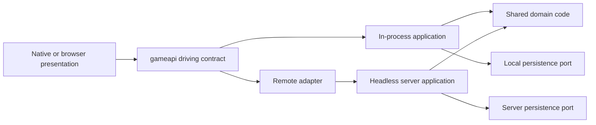

# Architecture

This document describes the architecture of World-wide High-speed Rail Tycoon. The [first-business slice](docs/validation/FIRST_BUSINESS.md) implements domain/application/API boundaries, direct-service demand and finance, construction and funding, dedicated train leases, native ebitenui controls, an Ebitengine map, a semantic browser HUD, a headless CLI and development saves. Transfer markets, the worldwide data pipeline, production save contract and multiplayer server remain planned. Earlier map and widget prototypes remain separate reference artifacts.

The [game design](docs/DESIGN.md) owns gameplay rules and domain invariants; [UX](docs/UX.md) owns interaction behavior; [testing](TESTING.md) records verification commands and release gates. The [state/storage contract](docs/STATE_AND_STORAGE.md) defines Go type shapes, portable save v1, the SQLite server backend and migration policy. Numeric camera settings and cost assumptions live in their linked manifests. This document explains the system boundaries that realize those requirements. Proposed balance and recovery policies retain their status from the design; listing them here does not make them calibrated or implemented.

## Architecture style

Use Clean Architecture, domain-driven design (DDD), command/query responsibility segregation (CQRS), and explicit decorators for cross-cutting concerns. These are design commitments for the forthcoming game implementation; the isolated prototypes do not yet implement this architecture.

| Pattern | Application to this game |
| --- | --- |
| Clean Architecture | Dependencies point inward toward rules and use cases. Application-owned ports isolate storage, scheduling, networking, and diagnostics. Composition roots wire concrete adapters; the domain remains headless and independently testable. |
| DDD | Model the railway business using its own terms: projects, alignments, services, trainsets, access rights, obligations, and journeys. Entities have stable IDs; value types encode quantities and invariants. `World` is the aggregate root for atomic monthly/shared-market consistency, with company ownership enforced inside its operations. Construction, operations, demand, and finance are cooperating domain areas within this initial model. |
| CQRS | Separate state-changing commands from read-only inspections, forecasts, and frame projection. Both operate over the same authoritative world; UI-facing read models are isolated projections. Separate command/query databases and event sourcing are not required. |
| AOP through decorators | Wrap selected use-case and storage ports for structured logging, timing, and diagnostic outcomes, composed explicitly in Go. Keep authorization, business validation, reservations, and monthly transaction order visible in application/domain code. Runtime weaving or reflection-driven interception is not required. |

Keep aggregate boundaries aligned with invariants rather than creating a repository for every entity. A command changes domain state only through its aggregate operations. Dependency boundaries, query purity, frame isolation, and invariant preservation must be verified as described in [TESTING.md](TESTING.md#required-checks-as-the-game-is-implemented).

## One rules engine, two execution modes

Use a shared Go application/domain implementation for offline single-player and an authoritative dedicated multiplayer server. Desktop and browser clients use the same driving contract. Composition selects an in-process implementation or a remote adapter; presentation does not implement a second economy.

Local and server worlds are separate instances using the same rules code. Offline play has no server, login, network, or wall-clock progression requirement. The online server owns the shared world, private acknowledged plans, and schedule; clients submit intentions and receive authorized results. Clients animate the representative operating day from resolved summaries rather than receiving authoritative train positions every frame.

## Package boundaries

The following is the target layout. Milestone 1 implements a small subset; its actual inventory and qualification are linked above.

| Package | Responsibility | Boundary |
| --- | --- | --- |
| `internal/domain` | World, construction, fleet, services, demand, itineraries, finance, monthly resolution | Pure rules; no renderer, storage, networking, audio, or wall clock |
| `internal/application` | Commands, forecasts, validation orchestration, frame projection, persistence mapping and coordination | Imports domain and public contracts; owns required adapter ports |
| `pkg/gameapi` | Commands, isolated frame DTOs, stable error codes, driving ports | No dependency on domain entities, rendering, or transport |
| `internal/adapters` | Filesystem/IndexedDB, remote game port, server transport/storage, diagnostic sinks | Implements ports; does not become a second owner of mutable world state |
| `pkg/ui` | Selection, drafts, scene stack, presentation preferences | Emits shared intents and consumes frames |
| `pkg/hud` | Management controls and intent translation | No direct domain mutation |
| `pkg/render` | Equal Earth map, layers, replay illustration, draw/pick transforms | Screen geometry cannot determine engineering distances or simulation outcomes |
| `pkg/app`, `pkg/audio` | Client composition, input/lifecycle, platform audio | Platform effects remain outside the domain |
| `cmd/server` | Headless composition and world coordinators | Must not import the client host or initialize graphics/audio |
| `internal/verification` | Public-API player policies and canonical checkpoints | Exercises driving contracts rather than privileged world mutation |
| `data`, `tools` | Versioned scenario inputs and offline preparation/verification | Prototype inputs are not automatically qualified production data |

Only application code translates public commands into domain operations and domain state into frames. Presentation never receives a mutable `World` pointer. Returned frames must be isolated from domain state, carry relevant revisions, and contain only information authorized for that company. Storage and network work use immutable copies rather than concurrently mutating a live world.

Africa2ice supplies reference patterns for these boundaries, not a runtime dependency. Reuse isolated frames, shared intents, guarded drafts, consistent coordinate transforms, asynchronous storage, and logging decorators selectively. Preserve source notices when copying code. Replace its ecological rules, fixed desktop layout, and sequential onboarding. The [design's reference notes](docs/DESIGN.md#11-architecture-informed-by-africa2ice) identify the inspected components.

## World ownership and monthly resolution

One `World` is the atomic consistency boundary. It owns companies, infrastructure and access rights, fleet, accepted plans, construction, auctions, protected funds, finance, and resolved history. Cities, corridor alternatives, and balance tables are immutable versioned inputs. A company can own several disconnected rail components; individual services and passenger journeys still require physical connectivity.

Commands either produce a complete valid result or leave the prior world unchanged. Use typed IDs and quantities, checked integer money, explicit units and rounding, and stable ordering for consequential allocation and tie-breaks. Forecasts and inspections are read-only.

Monthly resolution follows the [canonical order](docs/DESIGN.md#monthly-resolution-order): freeze plans and eligible assets, allocate shared capacity, derive delivered service, allocate the shared OD market to complete itineraries, post and reconcile cash flows, advance obligations/projects/orders, settle due auctions, complete next-month assets, and publish reports/checkpoints. An asset completed in this transition becomes usable next month.

The same seed, data/algorithm versions, and accepted commands must produce matching canonical checkpoints on supported native and WebAssembly targets. The domain does not read a wall clock or consume randomness during queries, forecasts, saves, or replay. Any future randomness must have serializable, versioned ownership. The operating-day replay is presentation state and cannot advance the business simulation.

## Commands, drafts, and multiplayer

Expose commands and queries through the game port, including construction quotes, service forecasts, accepted plan changes, snapshots, and storage operations. Keep stable machine-readable constraint codes separate from UI wording. Local/admin state hashes and full-world snapshots are not ordinary multiplayer player queries.

A UI draft is separate from an accepted plan. Previewing or editing does not spend funds. Applying online must receive a durable acknowledgment naming the revision and first effective month. After stale assumptions or an ambiguous response, retain the draft, refresh authorized state, and query the original operation identity before retrying a financial action.

The server serializes accepted operations within each world. Requests have version/world/phase/revision identities and idempotency keys; company identity comes from the authenticated session. Authorization covers queries and forecasts as well as mutations. Invite codes provide admission to private games, not a substitute for revocable sessions.

Publish committed project and access-offer summaries from the authoritative world after durable commit. The coordinator settles concurrent construction claims against the unordered pair, reviewed competition, and physical section identities. Service authorization and fees use effective track agreements and station rights before shared capacity is allocated.

New multiplayer worlds begin in a planning lobby with a fixed opening snapshot and a host-controlled start. The server scheduler sets the first deadline one full interval after the host starts. Online months then resolve on the fixed interval chosen at world creation, including while players are absent. The proposed default is 30 real seconds. Persist the interval, deadline, phase, acknowledged plans, and resolution identity. Commit the complete month durably before publishing it. The proposed recovery policy completes an already committed operation idempotently, resolves at most one overdue month after an outage, and schedules the next deadline one interval after recovery. Qualify that policy before release. Standing services and commitments continue according to acknowledged plans. Shared-world spending requires server acknowledgment.

Online auction cutoffs belong to the server host record. The server enforces the bid deadline (the longer of three real minutes and one interval) and includes the sealed auction IDs in the durable monthly lock. The domain settles those pinned bids using the same deterministic clearing rules as offline play.

## Geography and data preparation

Keep three distinct representations:

1. Geographic city coordinates and alignment polylines describe world locations.
2. Reviewed engineering intervals and rail speed profiles determine feasibility, length, cost, upkeep, construction duration, and running time.
3. Equal Earth projection and camera transforms determine drawing and picking only.

The first version uses a precomputed corridor catalog with curated alternatives. Passenger/service routing runs at runtime; global civil-engineering route generation does not. A direct line crossing water cannot invalidate a qualified overland alternative. Kinshasa–Lagos is the coastline-detour acceptance case: one continuous project may bend without adding intermediate stations. Missing catalog coverage must be distinguished from geographic impossibility.

The offline data pipeline must qualify full-route engineering coverage, terrain, shorelines, crossings, borders, and rights. Starting track is admitted as corridors between catalog cities, never by track tags alone. Missing terrain is unqualified data, never free flat land. A coarse Natural Earth overview cannot price tunnels or establish buildability. Cross-border costs use the jurisdiction of each engineering interval, not whichever endpoint is cheaper.

Current inputs and their scope:

| Input | Owning record |
| --- | --- |
| Original 96-record metro attachment and unresolved provenance | [Raw metadata](data/raw/metropolitan_areas_5m.metadata.json) |
| Current 94 major playable metros, each at least 5M; Manila and Brasília excluded | [Selection policy](data/prototypes/playable-metro-selection.v1.json) and [derived catalog](data/prototypes/playable-metros.v1.json) |
| Regional names, anchors, exclusions, orientation rules, latitude cushion, timezone defaults | [Camera preset manifest](data/prototypes/map-region-presets.v1.json) |
| Prototype country outlines | [Natural Earth manifest](data/prototypes/natural-earth-110m.metadata.json) |
| Regional construction assumptions, observations, normalization, and engineering factors | [Cost ledger](data/costs/construction_costs.v1.json) and [research](docs/CONSTRUCTION_COSTS.md) |

Preserve raw inputs and derive game catalogs with explicit transformations. Record source/version/hash identities in released scenario bundles and saves. The 94-metro prototype is not the complete worldwide corridor catalog; smaller intermediate cities and existing HSR stops remain part of the planned broader catalog.

## Presentation and camera state

Ebitengine is the proposed desktop/browser renderer, with ebitenui a demonstrated visual-widget candidate. The HTML/D3 map prototype is a feasibility/reference artifact, not an existing Go map implementation. Both product hosts must share the game port and rules regardless of their eventual control-rendering technology.

Use one forward/inverse camera transform for map drawing and picking. Layout uses logical space; framebuffer scale improves raster quality without shrinking controls. Phone task views reflow instead of scaling down a fixed desktop canvas. Contextual guidance reads frames and presentation preferences; enabling it cannot change simulation results.

Camera, selection, dismissed hints, replay position, and drafts are local UI state, separate from authoritative campaign state. Timezone-selected portrait defaults are calculated locally and give way to saved views. Region framing and the cushioned zoom floor follow the [UX camera contract](docs/UX.md#regional-camera-presets); retain those details in the manifest rather than duplicating regional tables here.

Localize in the client using stable message keys, typed arguments, and display names keyed by catalog ID. Frames, commands, saves, and server events carry canonical IDs, quantities, and reason codes so the client can render them in its own language. Keep the language preference outside campaign state. Bundle translation catalogs and fonts with the desktop and web clients. Use English as the fallback for missing interface messages and the source label for untranslated catalog names. [Localization requirements](docs/DESIGN.md#localization)

Milestone 1 selects ebitenui for native management controls and semantic HTML for the browser HUD; both use the same application commands and frame DTOs. Browser command handling runs independently of the renderer's update loop, so hiding the map cannot suspend a business command. Native company-name entry adapts Ebitengine's IME field into the ebitenui presentation instead of relying on raw character input. The native macOS accessibility tree currently exposes the window but no canvas management controls; browser semantics provide the accessible host for this slice. Physical-phone and actual native IME/screen-reader qualification remain open.

The [presentation contract](docs/PRESENTATION.md) requires a cheerful bright palette and state-grounded construction/train animation and sound. Renderer/audio consume frames and deduplicated presentation cues, never mutate campaign state, and honor reduced motion, mute and lifecycle preferences.

## Diagnostics and audit

Pervasive structured diagnostics are required, through explicit Go `log/slog` decorators/adapters and domain-returned facts. The [diagnostics contract](docs/DIAGNOSTICS.md) defines coverage, correlation, retention, privacy, support exports and reproducibility. Rolling diagnostic sinks are bounded and non-authoritative. Server canonical game requests and ordered audit events persist with world/host/receipt commits in SQLite; retry cannot duplicate a business event. Audit data is admin-private and separately projected for player-visible activity. Logging verbosity, dropped verbose events and audio/render tracing cannot alter canonical outcomes.

## Persistence and lifecycle

Use versioned JSON snapshots behind application-owned persistence ports, with filesystem and IndexedDB adapters. Persist a consistent world, not independent per-city/train repositories. Include data and algorithm identities, obligations, protected reservations, owned assets, plans, reports, and replay summaries. Server storage additionally owns scheduling and operation identities; authentication secrets stay separate from downloadable game data.

The dedicated server uses embedded SQLite via `database/sql` and `modernc.org/sqlite`, with a single connection/writer and transactional world/host-state/receipt commits. Entities stay in a versioned whole-world JSON snapshot; sessions and invite hashes stay in separate operational tables. Save, host-record and database schemas begin at v1; no historical game-save migration is needed yet. See the [detailed contract and reference artifacts](docs/STATE_AND_STORAGE.md).

Decode and validate into an isolated replacement world before swapping live state. Incompatible or corrupt loads preserve the current campaign. Serialize writes; acknowledge saves only after durable commit; preserve the previous slot on failure. Support portable browser export/import and a single browser storage writer. UI preferences/drafts use separate versioned records.

Native and browser lifecycle adapters handle audio activation, visibility, storage failures, and resume. Browser background timers do not control online deadlines. On reconnect/resume, refresh world, schedule, and uncertain operation status before enabling commitments.

## Decisions still to qualify

- Accessible browser/native control strategy and physical iOS/Android keyboard, safe-area, and lifecycle behavior.
- Native/browser transport, and implementation/qualification of the chosen SQLite server adapter and platform storage adapters.
- Worked deterministic rounding/shared-capacity allocation and cross-target checkpoint equality.
- Qualified existing-HSR inventory, corridor catalog, economic calibration, and data redistribution rights.
- Measured mobile/stress performance, memory, and shipped WebAssembly size.

Use [TESTING.md](TESTING.md) to distinguish existing prototype evidence from these implementation and release obligations.
