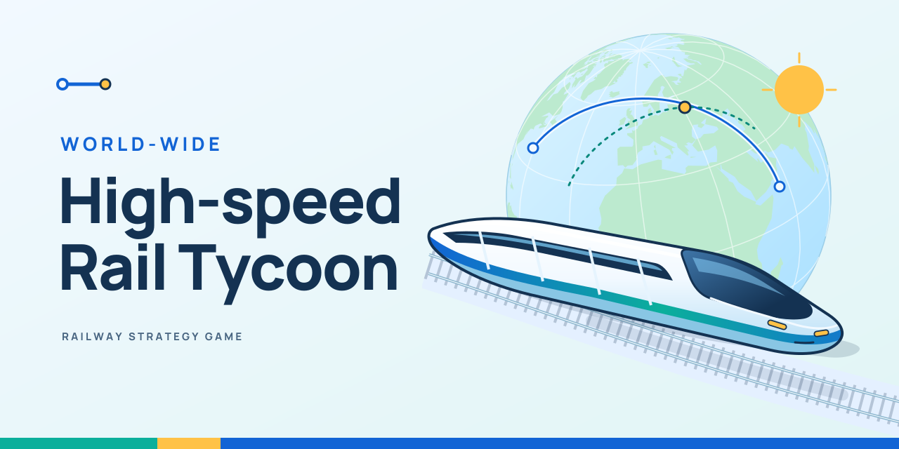

# World-wide High-speed Rail Tycoon

A strategic railway business game about operating and expanding the world's high-speed rail networks. Plan monthly business turns, watch an animated operating day, and compete for passengers through fares, frequency, speed, and useful connections.



Build independent lines between unserved cities, expand existing railways, or join separate networks. A new line can operate without connecting to the legacy network.

Real geography shapes expansion: compare longer valley routes with expensive mountain works, tunnels, and bridges, balancing construction time and upkeep against journey speed.

Single-player runs offline. Optional multiplayer connects competing companies to a private dedicated server. Players prepare in a planning lobby before the host starts the clock. The proposed default is 30 seconds per business month for a three-hour campaign, with a fixed interval chosen at world creation. Existing public lines can be acquired through reserve-price auctions while retaining regulated open access.

Committed construction is visible to every company. Owners can offer paid track access on new private lines. Online auctions give players at least three real minutes to bid. Every station is open access at regulated fees.

The first playable business slice now runs in East Asia: operate the Tokyo–Nagoya starter service, adjust fares and frequency, lease trains, borrow for construction, compare terrain-aware alignments, build a new line, and collect passenger revenue in monthly reports. Native controls use ebitenui; the browser has semantic HTML controls over the same Go/Ebitengine map and rules. English and Simplified Chinese are bundled.

The prototype's existing HSR map is now playable worldwide, including China. Choose **China** in the Map region selector (**Map controls** in the browser), then **Services → Find a service** to search for **Beijing Shanghai** (or **北京 上海**). Lease the required trains and apply a frequency/fare plan; monthly reports include through passengers and access fees. The catalog includes 300 existing corridor records, 74 construction prospects and 3,937 service templates. The playable map shows 2,548 associated station markers; the full 4,333-record station inventory remains available for review. Service stops use strategic city hubs; other source stations are inspectable map features. See [import scope and provenance](data/imports/README.md). [Topology repairs](docs/validation/NETWORK_TOPOLOGY.md) restore the full Northeast Corridor, Uzbekistan and the other audited networks, retain published route IDs and preserve historical accounts through the version-10 save upgrade.

To start over, open **Company → Identity → New game** and confirm replacing the current save. This restores the January 2029 starting company and starter service while keeping display preferences.

Choose **Company → Settings → Appearance** for System, Light or Dark mode. System follows your device; the saved choice covers controls, the map and terrain, including offline play.

The command dock can sit across the top or on the left. Change it in **Company → Settings**, or drag the divider to widen the task inspector. Services, construction, company tools and reports have focused tabs; optional detail opens on demand. Layout preferences survive restarts and New game.

Run the native client from this checkout:

```sh
go run ./cmd/wwhsrt
```

The browser version of the latest `main` that passed CI is at <https://adsouza.github.io/wwhsrt/>. To build and serve it yourself:

```sh
sh tools/build-web.sh
go run ./cmd/webserve
```

Open `http://127.0.0.1:8765/`. Once its offline cache has installed, the browser client can reload and play without networking. Native play has no network requirement. `sh tools/build-native.sh` also produces a native executable and a macOS development app bundle on macOS.

The [first-business notes](docs/validation/FIRST_BUSINESS.md) explain controls, funding, model assumptions, save locations and remaining qualification. [TESTING.md](TESTING.md#first-business-slice) lists focused checks. The graphics-free CLI uses the same application: `go run ./cmd/headless -advance 2`.

[Milestone 3](docs/validation/MILESTONE_3.md) adds Tokyo–Nagoya–Osaka through-running, transfers, shared track/station capacity, finite passenger markets with road/air competition, company-wide forecasts and an interactive representative day. In Services, choose **Tokyo → Nagoya → Osaka** to extend the starter service and explicitly move/lease its fleet. Valid version-2 saves upgrade without resetting the company or rewriting historical accounts. Multiplayer remains milestone 4.

[Milestone 2](docs/validation/MILESTONE_2.md) adds explicit station readiness, the Swift 400 train family and costs, reconciled engineering breakdowns, and contextual guidance through the first-business loop. Existing version-2 saves and economic balances are preserved. These milestone-2 notes retain the earlier implementation history.

The [game design specification](docs/DESIGN.md) records the current design, confirmed choices, proposed rules, and delivery milestones. The broader worldwide game and multiplayer server remain planned.

The [architecture](ARCHITECTURE.md) describes system boundaries, offline/server execution, data preparation, presentation, and persistence. The [testing guide](TESTING.md) separates current runnable prototype checks from planned implementation and release gates.

The [state and storage contract](docs/STATE_AND_STORAGE.md) defines concrete Go reference types, JSON save v1 and schema, SQLite server transactions, recovery, and migrations only when a released format actually changes.

The [interaction and UX specification](docs/UX.md) defines map-centered decisions, contextual learning during ordinary play, and complete phone workflows that expand into simultaneous map, planning, and comparison views on larger displays.

The [presentation specification](docs/PRESENTATION.md) defines the bright palette and construction/train motion and sound. The [diagnostics contract](docs/DIAGNOSTICS.md) defines pervasive event logging, durable audit history and support bundles.

The [world-data notes](data/README.md) describe the supplied 96-metro seed, its population and GDP estimates, and the track and station audits for the launch map. The [launch corridor shortlist](docs/LAUNCH_CORRIDORS.md) records the 74 proposed links for alignment authoring and qualification.

The [construction-cost research](docs/CONSTRUCTION_COSTS.md) supports 20 regional cost profiles, with HSR benchmarks, conventional-rail extrapolations, and explicit price/scope assumptions.

The [map and widget validation report](docs/validation/README.md) contains Equal Earth world/regional views of the playable metros derived from the 96-record seed (94 after Taipei's restoration) and screenshots/checks from an actual Go/WebAssembly ebitenui renderer. The [isolated rendering spike](tools/ebitenui-spike/README.md) runs independently of the future game.


All [74 launch projects](docs/LAUNCH_CORRIDORS.md) are now construction prospects:
choose a dotted route or use **Build a line → All 74 construction prospects**.
The picker keeps the ordinary plan compact. Regional costs use the researched
2024-USD profiles and authored terrain quantities; detailed costs show country
splits. Future through-services become available when every required section
opens, including Tokyo–Sapporo after the Hokkaido extension.

Morocco starts with dedicated HSR **Tangier–Kenitra only**. The conventional
continuation through Rabat/Casablanca is not a public HSR asset. Kenitra–Casablanca
and Casablanca–Marrakech are buildable projects. Lisbon–Porto retains its upgraded
conventional public service and offers a separately labeled new dedicated-HSR
project. [Construction qualification, compatibility and limits](docs/validation/LAUNCH_PROSPECTS.md).

Taipei is playable with through-service on Taiwan HSR. Houston–Austin is the 71st construction prospect and enables Houston–Austin–San Antonio through-running after both sections open. The Daegu–Ulsan alignment uses the mapped Gyeongju connector without the Yeongcheon turnaround. See [regional repairs and compatibility](docs/validation/REGIONAL_NETWORK.md).


The connector expansion adds **Tsuruga–Maibara**, **Valencia–Camp de Tarragona**
(reusing existing HSR onward to Barcelona) and **Porto–Vigo**, with through-service
options. Existing Turin–Milan and Perpignan–Figueres–Barcelona are repaired public
railways. Maibara joins the existing Tokaido network. Historical company accounts
and accepted services survive the v10 upgrade; see [scope and checks](docs/validation/NETWORK_BRIDGES.md).
