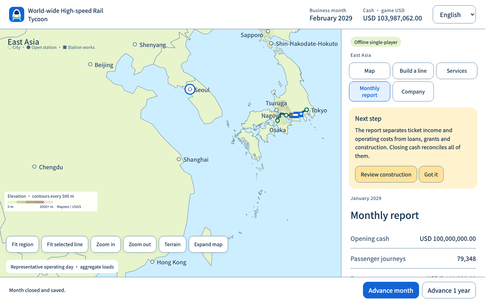
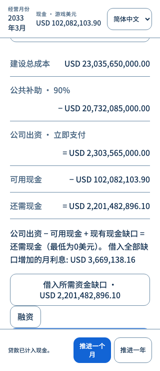

# First playable railway business

This development slice replaces the inert walking skeleton with a build-and-operate loop in East Asia. It starts a **fresh company** with USD 100M, two leased 400-seat trains dedicated to Tokyo–Nagoya, and an accepted service of six return trips per day at USD 90 one way. Advancing the first month carries **79,348 passenger journeys**, collects **USD 7,141,320**, posts **USD 3,154,258** in operating costs, and closes with **USD 103,987,062**. These are deterministic scenario results, not real railway accounts.

## Playing

Milestone 3 adds network services, including **Tokyo → Nagoya → Osaka**. Choose that pattern in Services to explicitly extend the starter service, transfer its two trains and lease one more for six daily return trips. [Network rules and controls](MILESTONE_3.md) cover transfers, competing modes, shared capacity, passenger inspection and the representative-day replay. Current fresh-company figures above use network rules; historical version-2 reports retain their original values.

The native Company name editor supports click/drag and double-click selection, Shift selection, Home/End, word movement, Select All, copy/cut/paste and undo/redo (Command shortcuts on macOS, Control elsewhere). It keeps IME composition separate from accepted names; editing saves only the local draft until **Apply name**. Selection and undo history survive a panel resize. Clipboard failures preserve the draft. Linux clipboard access requires `wl-clipboard` on Wayland or `xclip`/`xsel` on X11; unavailable access is reported without erasing text. Browser names retain their ordinary HTML input behavior.

Milestone 2 now exposes station delivery and the fictional **Swift 400** train family. Existing public stations are operational immediately. An independent project creates its missing endpoint station works and opens them with the line; an existing public station keeps its ownership and opening status. The map distinguishes stationless cities, open stations and station works, and selected-city details show ownership/readiness. Services publish the actual 400-seat family, lease, running/access/handling charges and fleet-day assumptions; extra details can be expanded. Basic station works are bundled without a separate capital bill in this introductory model.

One contextual **Next step** cue follows the active task through starter revenue, funding, construction, opening, fleet/service planning and reports. Its navigation shortcuts preserve the plan, and financial changes still require explicit actions. **Got it** hides guidance; Company can restore it. Guidance is presentation only, cannot change quotes or allocation, and never gates gameplay.

Construction funding previews in Build and Company name the selected city pair and alignment and show the signed calculation: total cost − grant = company contribution; contribution − available cash + any existing cash deficit = additional cash needed, floored at zero. For the fresh Tsuruga–Osaka tunnel plan this is USD 19,816,110,000 − USD 17,834,499,000 − USD 100,000,000 = **USD 1,881,611,000**. Company offers **Review this route** to inspect/change that plan. The full-gap loan and its monthly interest are distinguished from the editable custom loan amount and its interest. Committed/public lines do not offer another construction-funding quote. This is explanatory UI; prices, grants and loan rules are unchanged.

**Appearance:** Company offers System, Light and Dark. The native button cycles through these choices; the browser uses a selector. System follows live OS/browser appearance, with light as the fallback when the OS cannot report a preference. Both palettes cover controls, dialogs, warnings, map water/land, terrain, labels, city markers and routes. The preference is local, works offline and survives New game. Changing appearance does not issue a business command or affect saved campaign hashes.

The native app remembers its window size and monitor-relative position in `ui.json`, including the normal bounds used when restoring a maximized window. It saves after movement/resizing settles and flushes on normal close. Missing displays or invalid/offscreen bounds recover onto an available monitor. This presentation preference survives New game; browser window placement remains controlled by the browser.

- **New game:** open Company and choose New game. A confirmation names the current company and date, explains that the current save will be replaced, and offers Cancel (Escape also cancels). Confirming starts Sunrise Rail in January 2029 with USD 100M, no debt/projects/reports, and the original two-train Tokyo–Nagoya service. Language, motion and terrain preferences remain; drafts, map selection, expanded mode and dismissed onboarding reset. The action is also available after month 360. A failed save keeps the old game and confirmation open for retry.

- **Services:** choose an open service pattern, adjust its end-to-end fare/frequency, inspect passenger/revenue/cost/fleet forecasts, then apply. An active unapplied draft must be applied or restored before advancing. Lease/return trains explicitly; each train stays assigned to its service pattern, with explicit moves for a service extension. Idle leases continue to cost money. Frequency zero suspends service.
- **Build a line:** choose two cities in either order, using the list or map. The two construction opportunities have a tunnel route and a longer valley alternative. A corridor disappears from Construction opportunities as soon as construction is committed and stays absent after opening or reload. Selecting its endpoints still shows construction progress or service readiness. Compare kilometres, engineering, construction duration, gross cost, the 90% capital grant, the company contribution paid now, and potential operating contribution after opening. **Fit selected line** and expanded map mode help inspect the alignment.
- **Company:** enter the loan amount you want, up to the remaining USD 5B credit limit at 2% annual interest, or repay principal. **Borrow funding shortfall** takes one loan for the selected alignment’s company contribution minus available cash. The form previews added monthly loan interest; you may enter more for a cash buffer. Borrowing is explicit. Negative cash incurs a disclosed 1% monthly overdraft charge. Construction cannot start without the company's contribution in cash.
- **Advance month / Advance 1 year:** resolve one or up to twelve actual business months. Each month posts fares, running costs, public-track and station access, all leases, owned-line upkeep and interest. Construction opens at its recorded ready month; it cannot run early. After opening, lease trains on the new corridor and apply its first service. A year advance is one atomic save containing twelve individually reconciled reports.
- **Monthly report:** shows passenger journeys and the full cash reconciliation. Grants, construction spending, borrowing and repayments remain separate from operating costs. The operating-day illustration uses resolved service summaries. Track styles distinguish public rail, owned open rail, construction and draft alignments.

The native sidebar supports mouse-wheel/trackpad scrolling and a visible draggable
scrollbar for overflowing views, including populated monthly reports. Page Up/Down
and Home/End provide keyboard navigation; text fields keep their editing keys.
The scrolling area ends above the fixed month-advance footer. Native widget-event
regressions exercise the full scroll range in both languages and at narrow sizes;
they are separate from OS input and accessibility qualification.

Open owned lines with no accepted positive-frequency train service now produce a
persistent amber warning in both hosts. It shows monthly upkeep and idle-lease
costs, stays visible beside time advancement, and links directly to Services for
an affected line. Leasing alone or editing a draft does not clear it; applying a
running service does. Suspension restores the warning. Public track only warns
when the company is paying for idle trains there, so untouched public sections
are not false alarms. Future construction is excluded until it opens. These are
read-only notices; intentional suspensions remain possible without a modal gate.

`Frame.idle_lines` is derived from authoritative world state and uses the same
maintenance/lease amounts as settlement. It is not added to the save payload or
canonical checkpoint, and this projection itself needs no additional save fields. Focused application
tests check opening, costs, fleet/service changes, suspension and reload. Native
widget checks cover warning/footer width and height down to 320×480 in both
languages; browser checks cover the persistent 320px footer and the service shortcut.

## Scenario and financial assumptions

The map includes [offline regional terrain](../../assets/terrain/README.md): elevation tint/hillshade, 500 m contours, named mountain and lowland references around Hokkaido and Kansai, Lake Biwa and finer Japanese coastlines. **Terrain** toggles the layer; alignment descriptions explain the trade-off and remaining tunnels. [Focused terrain evidence](terrain-checks.json) and screenshots cover desktop/phone rendering and offline behavior. These are display references, not surveyed alignments or new economic inputs.

The [current route-water audit](route-geography-checks.json) corrected five of the six scenario alignments: both Hokkaido and Tsuruga alternatives and the existing Nagoya–Osaka section. Routes now avoid the checked sea/lake interiors; Lake Biwa approaches use its eastern/southern shores, and Hokkaido no longer cuts across Uchiura Bay. Added shape points are not stations. [Scope and provenance](../../data/geography/README.md) distinguish these regional drawings from engineering qualification. That earlier geography revision reset the test company as authorized; unrelated older catalog hashes remain incompatible. The current milestone-3 migration preserves valid version-2 companies.

The scenario has the previous nine East Asian metros plus approximate display references for Tsuruga, Shin-Hakodate-Hokuto and Sapporo. Starting public sections are Tokyo–Nagoya and Nagoya–Osaka, inspired by the operational [Tokaido Shinkansen](https://global.jr-central.co.jp/en/company/about_shinkansen/). Train seating, service times, fare response, markets and access/lease prices are game assumptions. The demand model compares fare, journey time and waiting against an abstract road/air outside option, then caps carried passengers by offered seats. Milestone 3 replaces independent corridor markets with bounded directed OD/class markets and shared seat allocation across direct, through and transfer itineraries. Abstract mode eligibility is explicit; the separate multiplayer server remains later work.

The two proposed buildable pairs come from launch shortlist entries 52 and 53: [Shin-Hakodate-Hokuto–Sapporo](https://www.jrtt.go.jp/english/project/hokkaido.html) and [Tsuruga–Osaka](https://www.jrtt.go.jp/project/hokuriku-tsuruhan.html). JRTT describes about 212 km and 80% tunnel for the Hokkaido extension; this scenario's rounded tunnel alternative uses 212 km, including 170 km of tunnel. The other engineering quantities, route sketches and durations are authored **game estimates**, not qualified real-world alternatives or opening forecasts. JRTT's real Hokkaido opening outlook is around early 2039 with further delay risk; the game's 48-month build is a pacing choice.

Construction quotes freeze the [Japan regional profile](../../data/costs/construction_costs.v1.json): baseline USD 20M/km, including USD 3M/km systems; civil factors 1 for surface, 1.5 for hills, 2.5 for viaduct and 5 for tunnel. Add 15% management, then 20% contingency to that subtotal. Every kilometre belongs to an engineering category. An introductory public grant pays 90% of gross construction at commitment; the player funds the balance. Owned-line upkeep is gross cost / 6000 per month (0.2% annually). These grant and upkeep choices are balance assumptions.

| Pair / alternative | Length | Tunnel | Build months | Gross cost | Company contribution |
| --- | ---: | ---: | ---: | ---: | ---: |
| Tsuruga–Osaka / tunnel | 205 km | 140 km | 36 | USD 19.81611B | USD 1.981611B |
| Tsuruga–Osaka / valley | 260 km | 20 km | 48 | USD 11.6334B | USD 1.16334B |
| Hokkaido / tunnel | 212 km | 170 km | 48 | USD 23.03565B | USD 2.303565B |
| Hokkaido / valley | 300 km | 45 km | 60 | USD 16.43235B | USD 1.643235B |

This retains the limited East Asia construction/fleet catalog and now implements the milestone 3 network loop, with [current evidence and qualification limits](MILESTONE_3.md). It does not qualify full production geography, engineering inventory, capacity upgrades, train purchasing, multiplayer or restructuring.

## Running and storage

Use `go run ./cmd/wwhsrt` or the app produced by `sh tools/build-native.sh`. For the browser, run `sh tools/build-web.sh`, then `go run ./cmd/webserve` and open `http://127.0.0.1:8765/`. The native app bundles the train icon. Both hosts use the same Go application and canonical checkpoints; headless replay accepts `-commands path/to/commands.json`.

The fresh company has a separate native directory: `os.UserConfigDir()/wwhsrt/first-business/` (macOS `~/Library/Application Support/wwhsrt/first-business/`), overridable with `WWHSRT_DATA_DIR`. The browser uses IndexedDB `wwhsrt-first-business` and separate UI preferences. Per the requested fresh start, there is no walking-skeleton save migration. Earlier development saves are not loaded into this scenario.

Development format **`wwhsrt-first-business`, version 3** pins exact scenario, construction and network data bytes and rules version. Version 2 saves open without resetting the company and upgrade on the next successful command, retaining historical reports. It stores company cash/debt, pending capital/financing flows, projects, accepted services, dedicated train leases, reports and resolved service summaries. The limit is 1 MiB, 360 months, one million commands and 32 leases. Validation checks required fields, version/hash identity, unique ownership/assets, opening/fleet eligibility, passenger/revenue bounds and cash/debt/grant reconciliation. Failed writes preserve the accepted state. The full production `wwhsrt-save`/SQLite contract remains planned.

## Verification

The focused Go checks exercise live revenue, fare/capacity response, quotes without mutation, insufficient funding, duplicate construction, project completion, isolated-component operation, train dedication, suspensions, idle costs, interest rounding, failed-save atomicity, continuation, isolated frames and rejection of corrupted financial/ownership records. Existing calendar, input, projection and filesystem checks also run.

The [browser result](business-checks.json) records the exact WASM hash and native-headless/WASM checkpoint after the same UI command sequence. It covers real controls from initial revenue through borrowing, reversed endpoint selection, alternative quote, construction, opening, lease, service and new-line revenue; Chinese composition; draft/fleet constraints; 320–1920px layouts; save failure; reload; single-writer ownership and offline continuation. Physical phones, native IME, native screen-reader support, power-loss durability and Windows/Linux runtime qualification remain open. Hosted CI is configured; a local run does not establish its remote status.

