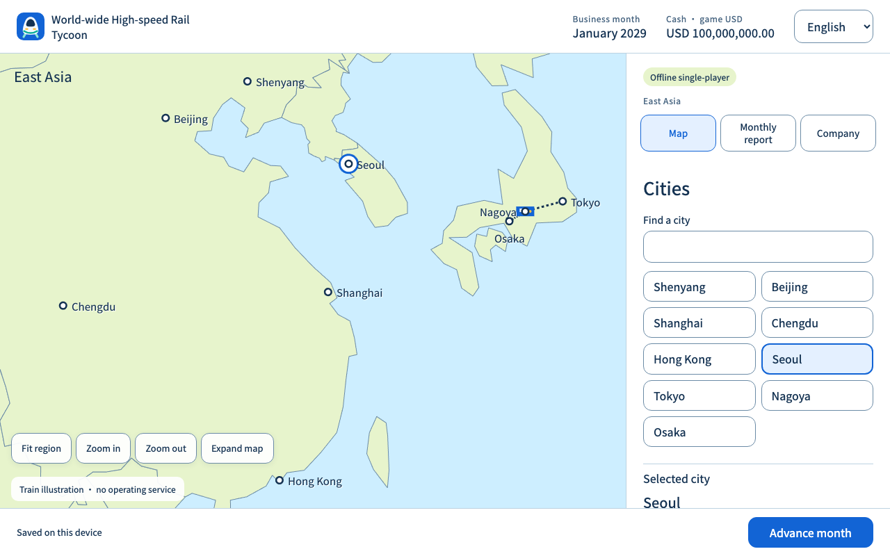
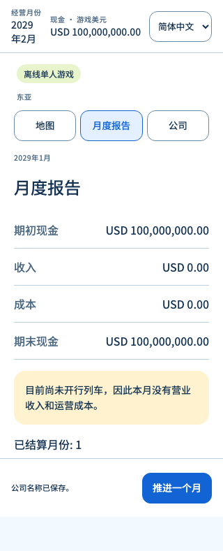

# Milestone 1: walking skeleton

Historical milestone-1 evidence. The current application is the [first-business slice](FIRST_BUSINESS.md), with construction and revenue; the controls and save format described below belong to the earlier build.

The first runnable slice starts in **East Asia**, using nine metros from the supplied catalog. It has an Equal Earth map, map/list selection, pan/zoom, a monthly calendar, an honest zero-service report, a Tokyo–Nagoya–Osaka train illustration, contextual guidance, local persistence, and English/Simplified Chinese interfaces.

Native controls use **ebitenui 0.7.3** with **Ebitengine 2.10.5**. Browser management controls are semantic HTML; the map and rules run in the same Go/WASM build. Both hosts and `cmd/headless` use `pkg/gameapi.Game` and the shared domain/application. This slice has no construction, fleet, demand allocation or operating economy yet.

## Run and use

From the checkout, `go run ./cmd/wwhsrt` opens the native client. `sh tools/build-native.sh` creates `build/wwhsrt` and, on macOS, a development app bundle. For the browser, run `sh tools/build-web.sh`, then `go run ./cmd/webserve`, then open `http://127.0.0.1:8765/`. All fonts, translations and geometry are bundled; the browser's installed service worker supports subsequent offline cold launch.

Select a city on the map or in the list. Drag to pan; use wheel/pinch or the zoom/fit controls. Browser **Expand map** hides the inspector; **Restore layout** or Escape brings it back. Phone task tabs open reports and company settings without requiring the map to remain visible. **Advance month** persists one transition and opens the report. No clock advances while you are away. Company-name edits remain drafts until **Save company name**. The contextual hint is optional and remembers dismissal. Reduced motion defaults from the browser's system preference and can be overridden.

Landscape framing uses Shenyang, Chengdu, Hong Kong and Tokyo; portrait adds Yangon as a camera anchor. The whole window determines orientation. The map outlines and illustrative route are display data, not qualified track/engineering inputs. [Scenario provenance](../../assets/scenario/README.md)

## State and recovery

The native client keeps `campaign.json` and `ui.json` under `os.UserConfigDir()/wwhsrt/walking-skeleton/` (macOS: `~/Library/Application Support/wwhsrt/walking-skeleton/`). `WWHSRT_DATA_DIR` selects a separate development directory. Native campaign ownership uses an OS file lock. Browser campaign bytes use one IndexedDB transaction per acknowledged command; a Web Lock excludes another writing tab. A closing/reloading tab releases ownership with a short grace period for handoff. Selection, language, dismissed guidance and unapplied name live in separate local presentation preferences. Camera pan/zoom is session state in this slice.

Local checks used Go 1.27.1 on macOS arm64. Snapshots use bounded, versioned **`wwhsrt-walking-skeleton` development format 1**, with exact scenario/rules identity and payload SHA-256. The development format allows up to one million commands and 360 resolved months, with a 256 KiB snapshot limit. Restore validates every report and refuses unknown, malformed or incompatible data without overwriting it. Commands apply to a candidate world; failed persistence leaves the live month and prior committed bytes intact. Reports retain explicit company IDs, opening cash, revenue, costs and closing cash. There is no income or spending before operating systems exist.

This small development format does not implement the full production `wwhsrt-save` contract. No historical migration exists. An incompatible development snapshot is preserved and reported, rather than silently reinterpreted. Browser **Export development snapshot** and headless `-save path` make the format inspectable. The [production storage specification](../STATE_AND_STORAGE.md) remains the contract for later financial saves and the dedicated server.

## Evidence and remaining qualification

[Automated results](milestone1-checks.json) identify the built WASM hash, browser version and matching native-headless/WASM checkpoint. [Testing commands](../../TESTING.md#first-business-slice) reproduce focused Go and browser checks. The browser checks cover actual controls, AX names, synthetic touch/IME, reflow, save failure, reload, single-writer ownership, offline launch and corruption preservation. Focused Go checks cover report reconciliation, calendar/campaign boundaries, failed-command atomicity, isolated frames, invalid snapshots and continuation. Import checks establish the graphics-free headless path and the initial domain/API boundary.

The macOS arm64 native window was launched and visually inspected. Its management widgets do **not** appear in the macOS accessibility tree; the browser's semantic HUD is the accessible host for this slice. Native screen-reader support remains an implementation gap. Real native Chinese IME, VoiceOver interaction, physical iOS/Android keyboards, OS termination/recovery and Windows/Linux runtime behavior still need device/human qualification. Synthetic browser composition is not proof of those paths. The hosted workflow is configured; no remote CI result is claimed by this local evidence.

