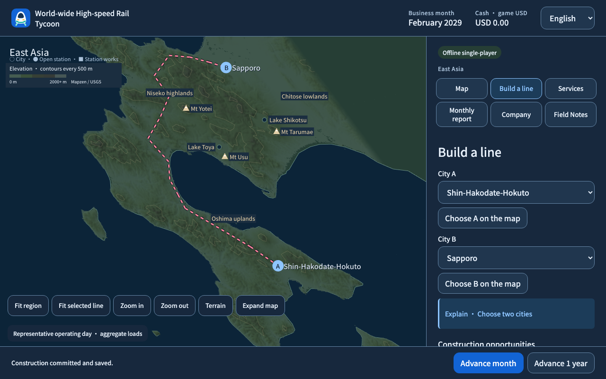
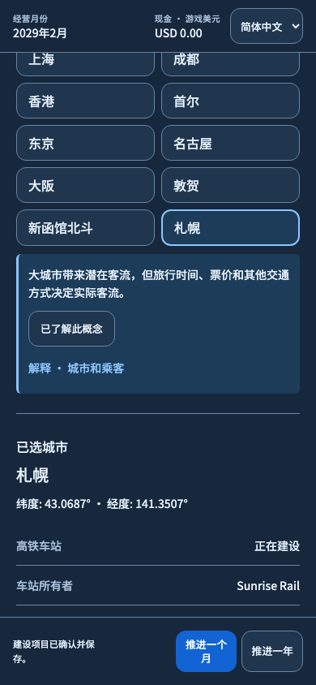
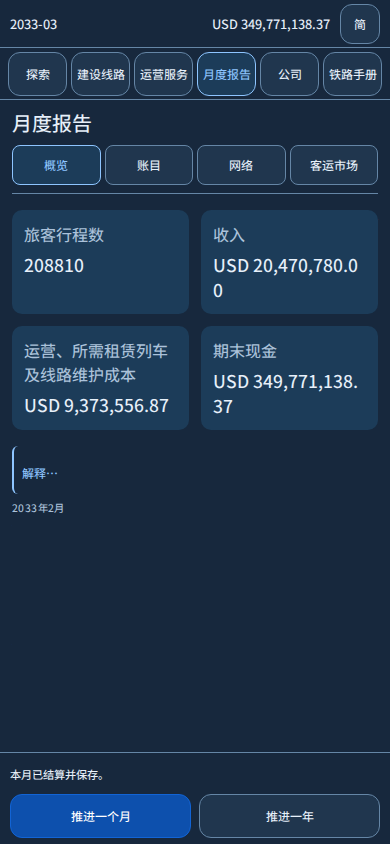

# Milestone 2 — first business

Implementation and verification checkpoint for the limited East Asia first-business slice. The owning milestone definition is [DESIGN.md §14](../DESIGN.md#14-delivery-sequence-and-acceptance). Through-running, transfers and shared network allocation belong to milestone 3.

## Implementation scope

| Requirement | Implementation |
| --- | --- |
| 8–12-city map and existing HSR start | Twelve map cities; Tokyo–Nagoya–Osaka public sections; active Tokyo–Nagoya starter service |
| Independent extension to an unserved city | Shin-Hakodate-Hokuto–Sapporo had neither starting station when this milestone shipped; the expanded public network now ends at Shin-Hakodate-Hokuto, so the checker reuses that public station and the project builds Sapporo's |
| Substantial terrain barrier and alternatives | Hokkaido/Kansai tunnel and valley packages, terrain context and component cost breakdown |
| Construction and stations | Track and basic endpoint station works share the project's opening date; public stations are reused; city, construction and operating-station markers are distinct |
| One train family and direct services | Fictional Swift 400, 400 seats; published lease, running, access, station-handling and fleet-availability assumptions |
| Fares, access, costs, loans and grants | Existing direct-service demand, explicit service acceptance, reconciled monthly accounts, editable single loans and introductory 90% grant |
| Contextual onboarding | One dismissible contextual cue for the active task, ordinary action shortcuts and a Company setting; no tutorial or feature gates |
| Save/resume | Development save version 2; projections reconstruct station lifecycle and train family from pinned scenario/rules and saved projects/leases |

Station works are bundled into the introductory project package without separately modeled station capital bills or capacity upgrades. This is a deliberately limited station model. Station handling remains the established USD 0.50 per passenger journey covering both ends, including operation/servicing on owned stations. Public-track access remains USD 5 per operated train-km. The Swift 400 runs at USD 12/train-km, leases at USD 400,000/month, and uses a 16-hour operating day with 40 minutes of total terminal turnaround per return trip. Published family data is read from the same constants used by settlement and fleet validation.

Construction components use the existing Japan scenario rates and rounding: surface/hill/viaduct/tunnel works, 15% management, then 20% contingency. Totals and grants are unchanged. Station delivery, family details, cost components and contextual cues are projections, excluded from the economic snapshot and checkpoint. Existing version-2 saves need no migration or reset.

## Verification

Focused Go application/UI/native-widget checks cover station delivery and opening boundaries, independent operation, existing-station reuse, family/settlement consistency, component reconciliation, frame isolation, contextual cue transitions and dismissal, native sizing in both languages and themes, and unchanged established prices and starter economics. A copied current development save was loaded by the prior and updated headless builds with identical canonical checkpoint, cash, date and save bytes.

The [milestone 2 workflow](milestone2-checks.json) passes on the actual Go/WASM client: starter revenue, contextual guidance and dismissal, station inspection, component reconciliation, a terrain alternative, one-loan funding, independent construction, both station openings, local train leasing, accepted service, revenue, export/headless restore and offline continuation. Its accepted commands replay to the same native-headless checkpoint: `f954b9ecafda1af28abdf43079dff4d56f8bc387aa3c529498a614b4dc0ad6b9`.

The broader [business regression](business-checks.json) also passes on the same WASM: map input, keyboard controls, Chinese composition, 320–1920px reflow, loan validation, idle warnings, fleet constraints, financial reconciliation, write-failure atomicity, single-writer ownership, corrupted-save preservation, reload and offline play. Its established replay checkpoint remains unchanged.

Both native and browser targets build. The focused local Go checks were `go test -p 1 ./internal/application ./pkg/ui ./pkg/app -count=1`, with the repository's memory/process limits, plus the architecture import checker and bundled-font coverage. The full repository suite was not run locally, in accordance with TESTING.md. Hosted CI is configured to run native widget tests under Xvfb and both browser workflows; no remote CI result is claimed.

The rebuilt macOS arm64 app was launched in an isolated validation bundle/data directory after the Mac was unlocked. Dark-mode service planning visibly rendered the Swift 400 summary, all published family costs/operating assumptions, direct-service explanation, selected tab and station legend. Automated native pointer/keyboard attempts did not produce reliable control changes, so this is rendering evidence, not a native interaction pass. The isolated company remained at its initial month and the player's campaign was not reset. See [native observation](milestone2-native-checks.json). Physical phones, native assistive technology/IME, other desktop runtime platforms and production-scale data remain separate qualification.

