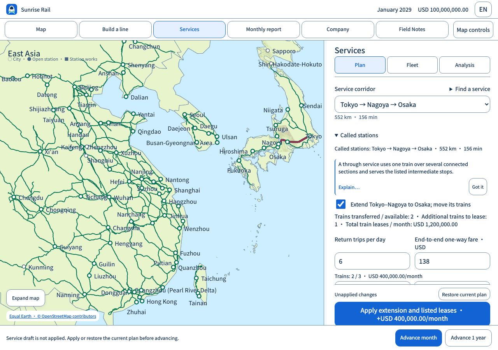
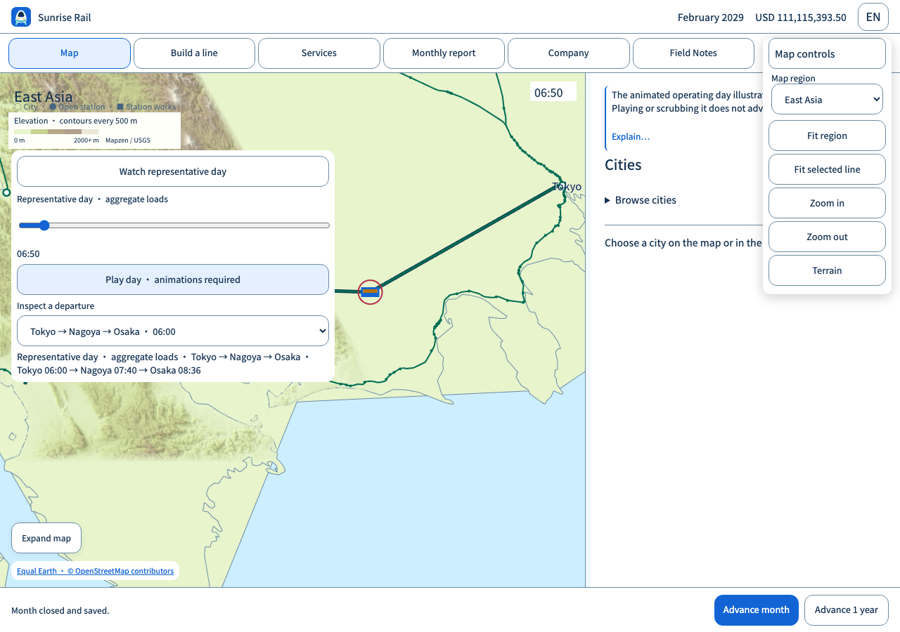
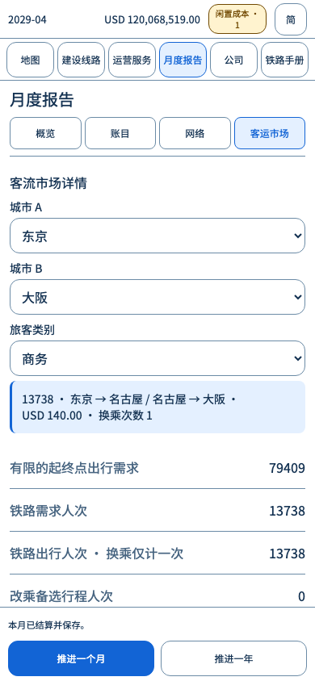

# Milestone 3: network game

The East Asia slice now separates a **service pattern** from a physical construction corridor. Tokyo–Nagoya–Osaka is an ordinary bidirectional through service, with Nagoya as a called station. The same sections can also carry shorter services. No new track or invented Tokyo–Osaka construction shortcut is created.

## Playing

In **Services**, choose **Tokyo → Nagoya → Osaka**. A new through plan offers **Extend Tokyo–Nagoya to Osaka; move its trains**. At six return trips/day, the 552 km, 156-minute pattern needs three Swift 400 trains: the extension moves the two starter trains and explicitly leases one more. Review the USD 1.2M monthly lease total and company-wide operating cash change, then apply. The original direct pattern is suspended. Failed validation or saving preserves both the original service and its fleet.

The selected pattern highlights all its sections. Called stations are listed separately; express variants serve terminals only. The fare control remains an end-to-end one-way price, converted to a distance-proportional tariff for partial rides. Canonical section rounding makes reverse fares identical and the full trip equal the displayed price, to the cent.

Reports offer **Network, capacity and passengers**, including delivered/requested train paths, station calls, journey counts, transfers, distance-weighted loads and rejected requests. The passenger inspector selects an origin, destination and class, then explains demand, eligible mode offers and carried itineraries. A journey using two services counts once as company ridership and once on each service's boarding total; fares are charged for the ridden distances, not twice for the whole journey.

After resolving a month, **Map → Watch representative day** provides a complete repeating day, time scrubbing, play/pause, departure selection and train picking. Trains follow the resolved service's actual section paths, dwell at called stations and show average directed-leg occupancy. The replay repeats every 24 simulated hours, with departures over the published 16-hour operating window. Playing advances ten simulated minutes per second at 60 updates/sec. Reduced motion can use scrubbing without animation. Replay never advances the business month or changes a campaign checkpoint.

## Rules implemented

- Twelve map cities have finite authored outbound trip budgets and attraction weights. Directed OD demand is apportioned from each origin budget, with 30% business / 70% leisure travelers. Classes use different values of time. These are balance inputs, not demographic or GDP-derived forecasts.
- Abstract road requires a shared authored road region; it cannot silently connect Honshu and Hokkaido. Air requires at least 250 km and includes terminal/access time. Conventional rail uses an explicit pair whitelist. No-trip/outside utility is always available. Prices, speeds, time values and eligibility are disclosed game assumptions.
- Routing considers called stations, up to two transfers, 4-minute intermediate dwells, expected waits capped at 120 minutes, 45-minute rail access/egress and a 20-minute transfer penalty. At most three ranked itineraries are retained per market/class. Each company offers its best eligible itinerary to mode choice, so duplicate patterns do not multiply demand.
- Public sections have 16 daily return paths; new private sections have 12. Each station allows 64 daily calls. Public requests are provisional and share capacity proportionally; company-controlled track/station overbooking is rejected. Scheduled empty trains consume paths and incur running/access costs.
- Seats are assigned jointly on every directed service section. Complete itineraries receive proportional allocations, with deterministic largest-remainder rounding and residual reallocation. Unserved rail requests may try one distinct feasible alternate; the remainder returns to original outside-mode proportions. No allocation creates passengers or seats.
- Trainsets are dedicated to a service pattern, with the existing 16-hour fleet-day and 40-minute return-trip turnaround assumptions. Required fleet covers requested frequency even if shared capacity later reduces delivered paths. The extension is an explicit atomic fleet move and lease order.
- Settlement charges delivered train-km on every section, public access on public sections, handling per service boarding, all leased trains and each owned section's upkeep once. A through service can reuse seats after intermediate passengers alight. Feeder/cannibalization revenue on other services and company-wide marginal operating cash flow are separate from the selected service's contribution.
- Idle notices distinguish physical infrastructure upkeep from idle service fleets and count their lease costs once. Operating a through service clears the no-service warning for every covered section.

The bounded catalog contains four direct and six through/express patterns, with constructed patterns becoming available when all their sections open. It is not a general worldwide path authoring UI. Station/track upgrades, additional train families, physical rolling-stock diagrams, seasonal/trend calibration, worldwide demand calibration, multiplayer access contracts and the authoritative server remain later work. The representative day illustrates resolved aggregate service, not a qualified dispatch timetable.

## State, compatibility and diagnostics

Development saves use `wwhsrt-first-business` **version 3**, rules `network-v3`, with exact scenario, construction and network-data hashes. Historical reports retain requested and delivered frequencies. Detailed market results and replay departures reconstruct from those plans and pinned inputs; they are not a second economic authority.

Version 2 saves are strictly validated and opened without writing or resetting the company. Their existing months keep their original accounts. The first successful subsequent command atomically writes version 3; the next resolved month uses network rules. A failed commit leaves the original version 2 bytes intact. Unknown versions and changed data hashes are rejected without overwriting the save. This development format remains separate from the planned production save/SQLite contract.

For compatibility, the existing `corridor_id` wire field on services and train leases is the stable **service-pattern ID**; direct patterns retain their old IDs. Physical construction/project IDs keep their original meaning. Routes explicitly list their physical sections, cities and called stations.

Structured logs record the network hash/rules, upgrade reads, service/extension command parameters, accepted/rejected commands, committed monthly accounts, network allocation totals and checkpoints. Company names, clipboard text and draft input are not logged. These local logs are diagnostic observations, not durable multiplayer command receipts.

## Verification

Focused Go checks cover through and intermediate journeys, transfers, express stopping rules, branch value, finite demand and outside eligibility, seat/path/station conservation, symmetric cent fares, largest-remainder rounding, service-order independence, fleet constraints, atomic extension/save failure, strict restore and version 2 continuation. `FuzzNetworkConservation` adds bounded generator seeds and a hosted fuzz gate. Native layout checks exercise services, expanded network reports and replay controls at 320–1920px in English/Chinese and both themes. Renderer checks cover train timing, dwell, reverse paths, picking and day repetition.

The broader [business regression](business-checks.json) also passes on the same final WASM, covering construction/funding, idle costs, ordinary fleet/service controls, keyboard and Chinese composition, narrow layouts, failed writes, single-writer ownership, corrupt saves and offline play.

The [browser workflow](milestone3-checks.json) drives actual controls through extension, save failure, representative replay, shared congestion, a Nagoya transfer journey, construction and feeder operation, Chinese phone/desktop layouts, export/reload, native-headless/WASM replay parity, a real version 2 fixture and offline continuation. [The checker](../../tools/check-milestone3.cjs) records the tested WASM hash. The rebuilt macOS arm64 app was also [visually inspected](milestone3-native-checks.json) in an isolated company: the Chinese dark service screen showed the selected through pattern, all called stations, fleet/fare controls and train markers without changing its economic checkpoint. Native builds, component checks and this rendering observation do not establish native OS interaction, physical phones, native IME or assistive technology; those remain qualification gaps. The full repository suite was not run locally; hosted CI owns it.

