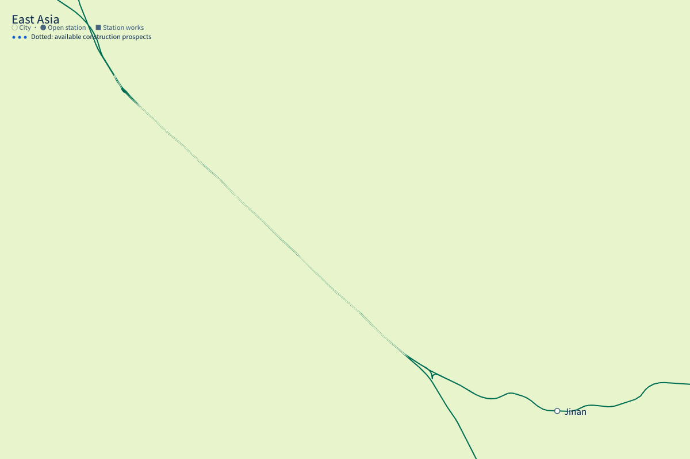
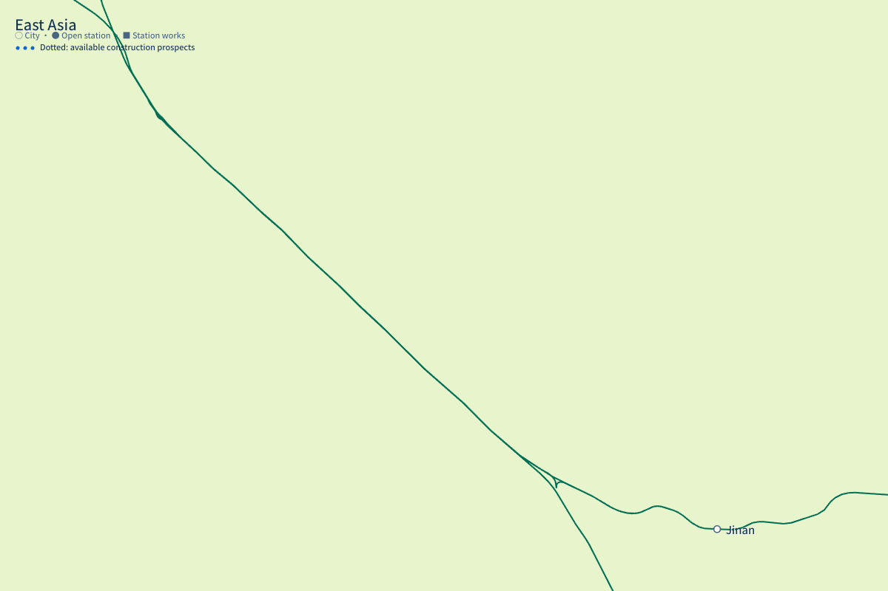

# Shared public track rendering

The Shijiazhuang–Jinan shared approach showed a pale, apparently broken section.
Its geometry occurs in several public corridor paths, including the longer
Shijiazhuang–Tianjin alias. Reversed copies were submitted together to the vector
rasterizer; their nonzero winding coverage cancelled part of the track stroke.
An isolated native render reproduced the gap without loading a company save.

The cached public layer now builds an exact, undirected union of source segments
and draws each segment once. Zero-length edges are omitted. No coordinate rounding
or proximity merging is used: distinct nearby parallel tracks remain distinct.
All original corridor paths, source stations, route selection, capacity identities
and save/catalog fingerprints remain unchanged. This applies worldwide to the
shared renderer used by native and browser clients.

The current public layer reduces 46,317 submitted segment instances to 34,880
unique strokes. On the affected approach, an actual native render had solid track
at only 6 of 21 sampled locations before the fix and all 21 afterwards. These are
samples of the reported defect, not a worldwide pixel audit.

| Before | After |
| --- | --- |
|  |  |

Focused verification: `GOMEMLIMIT=768MiB GOMAXPROCS=2 go test -p 1 ./pkg/render -count=1`
passed in 1.096 seconds. The new regressions check reversed/duplicate segments,
zero-length geometry, distinct parallel tracks, exact conservation of the entire
public edge union and all six overlapping route choices at the reported location.
Existing geometry/picking/cache tests also pass. The isolated native map captures
exercise the real Ebitengine renderer; they do not qualify interactive OS input.

Native and web builds are recorded in the [local ledger](shared-track-checks.json).
Complete browser/WASM startup was not retried because of its existing memory-cap
limitation. No user campaign was loaded or modified by the render harness.
